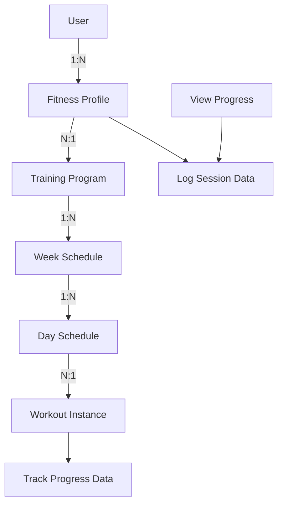

# Data Model

## Entity Definitions

1. **User**
   - **Attributes**:
     - `id` (Primary Key): Unique identifier for the user.
     - `full_name`: Full Name of the user.
     - `email`: Email address of the user. **(Primary Key/Unique Index)**
     - `birth_date`: Date of Birth of the user.
     - `gender`: Gender of the user (Male | Female).
     - `password_hash`: Hashed password for security.
     - `created_at`: Timestamp of when the user was created.
     - `updated_at`: Timestamp of the last update to the user's information.
   - **Relationships**:
     - Belongs to: None
     - Has one: FitnessProfile

2. **FitnessProfile**
   - **Attributes**:
     - `id` (Primary Key): Unique identifier for the fitness profile.
     - `user_id` (Foreign Key): References the User entity.
     - `age`: Age of the user.
     - `height`: Height of the user in meters.
     - `weight`: Weight of the user in kilograms.
     - `body_somatotype`: Body Somatotype of the user (mesomorph, ectomorph, endomorph).
     - `created_at`: Timestamp of when the fitness profile was created.
     - `updated_at`: Timestamp of the last update to the fitness profile's information.
   - **Relationships**:
     - Belongs to: User
     - Has many: TrainingProgram

3. **TrainingProgram**
   - **Attributes**:
     - `id` (Primary Key): Unique identifier for the training program.
     - `fitness_profile_id` (Foreign Key): References the FitnessProfile entity.
     - `name`: Name of the training program.
     - `description`: Description of the training program.
     - `program_duration`: Total duration of the training program in weeks.
     - `start_date`: Start date of the training program.
     - `created_at`: Timestamp of when the training program was created.
     - `updated_at`: Timestamp of the last update to the training program's information.
   - **Relationships**:
     - Belongs to: FitnessProfile
     - Has many: WeekSchedule

4. **WeekSchedule**
   - **Attributes**:
     - `id` (Primary Key): Unique identifier for the week schedule.
     - `training_program_id` (Foreign Key): References the TrainingProgram entity.
     - `week_number`: Number of the week in the program (e.g., Week 1, Week 2).
     - `repetition_duration`: Total duration the week repeats.
     - `start_date`: Start date of the week schedule.
     - `end_date`: End date of the week schedule.
     - `created_at`: Timestamp of when the week schedule was created.
     - `updated_at`: Timestamp of the last update to the week schedule's information.
   - **Relationships**:
     - Belongs to: TrainingProgram
     - Has many: DaySchedule

5. **DaySchedule**
   - **Attributes**:
     - `id` (Primary Key): Unique identifier for the day schedule.
     - `week_schedule_id` (Foreign Key): References the WeekSchedule entity.
     - `day_of_week`: Day of the week the workouts are scheduled (e.g., Monday, Tuesday, etc.).
     - `created_at`: Timestamp of when the day schedule was created.
     - `updated_at`: Timestamp of the last update to the day schedule's information.
   - **Relationships**:
     - Belongs to: WeekSchedule
     - Has many: WorkoutInstance

6. **WorkoutInstance**
   - **Attributes**:
     - `id` (Primary Key): Unique identifier for the workout instance.
     - `day_schedule_id` (Foreign Key): References the DaySchedule entity.
     - `workout_id` (Foreign Key): References the Workout entity.
     - `scheduled_reps`: Number of reps scheduled.
     - `scheduled_weight`: Weight scheduled for this workout.
     - `completed_reps`: Number of reps completed.
     - `completed_weight`: Weight completed for this workout.
     - `created_at`: Timestamp of when the workout instance was created.
     - `updated_at`: Timestamp of the last update to the workout instance's information.
   - **Relationships**:
     - Belongs to: DaySchedule
     - Has one: None

## Mermaid Diagram

### Relationship

```mermaid
erDiagram
    USER ||--|| FITNESS_PROFILE : has
    FITNESS_PROFILE ||--|| TRAINING_PROGRAM : has
    TRAINING_PROGRAM ||--|| WEEK_SCHEDULE : has
    WEEK_SCHEDULE ||--|| DAY_SCHEDULE : has
    DAY_SCHEDULE ||--o{ WORKOUT_INSTANCE : includes
    WORKOUT_INSTANCE ||--o{ WORKOUT : "can include"

    USER {
        int id PK
        string full_name
        string email UK
        date birth_date
        string gender
        string password_hash
        timestamp created_at
        timestamp updated_at
    }

    FITNESS_PROFILE {
        int id PK
        int user_id FK
        int age
        float height
        float weight
        string body_somatotype
        timestamp created_at
        timestamp updated_at
    }

    TRAINING_PROGRAM {
        int id PK
        int fitness_profile_id FK
        string name
        text description
        int program_duration
        date start_date
        timestamp created_at
        timestamp updated_at
    }

    WEEK_SCHEDULE {
        int id PK
        int training_program_id FK
        int week_number
        int repetition_duration
        date start_date
        date end_date
        timestamp created_at
        timestamp updated_at
    }

    DAY_SCHEDULE {
        int id PK
        int week_schedule_id FK
        string day_of_week "check is a valid day name"
        timestamp created_at
        timestamp updated_at
    }

    WORKOUT_INSTANCE {
        int id PK
        int day_schedule_id FK
        int workout_id FK
        int scheduled_reps
        float scheduled_weight
        int completed_reps
        float completed_weight
        timestamp created_at
        timestamp updated_at
    }

    WORKOUT {
        int id PK
        string workout_name
        text description
        int sets
        int reps
        float weight
        string equipment
        timestamp created_at
        timestamp updated_at
    }
```

### Flow Data

